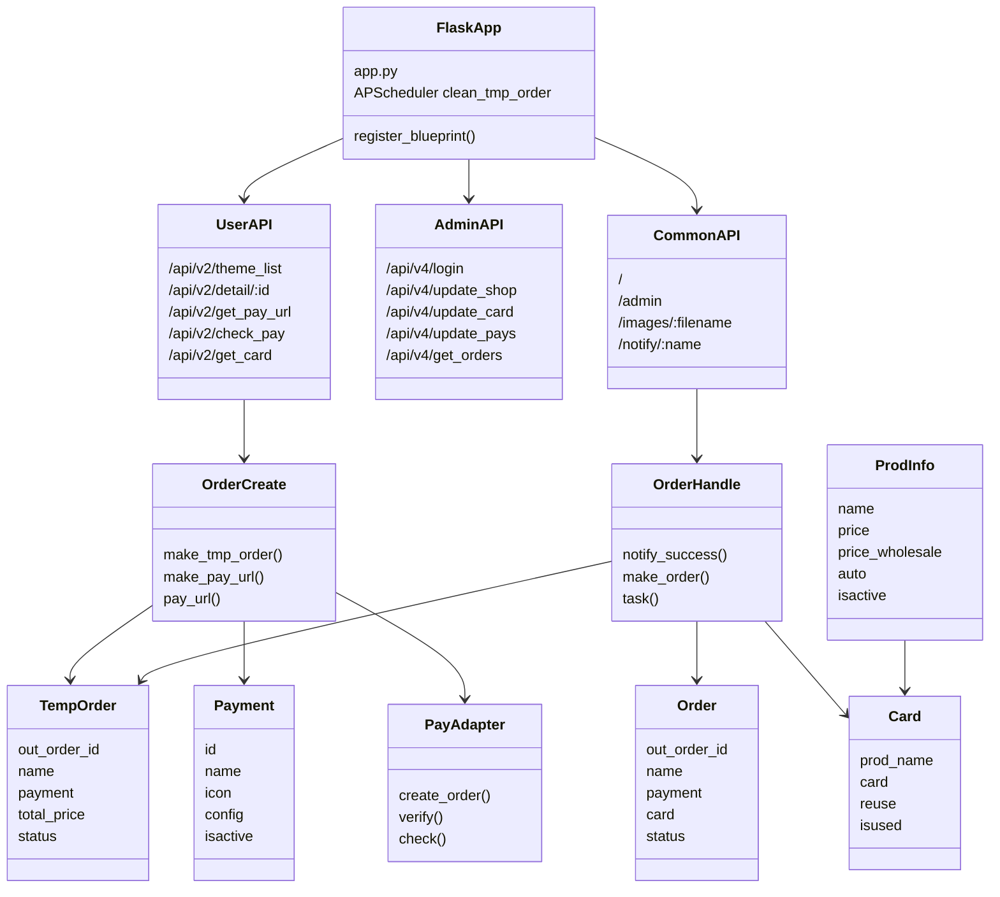
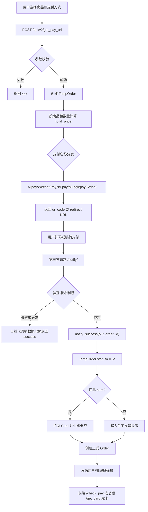
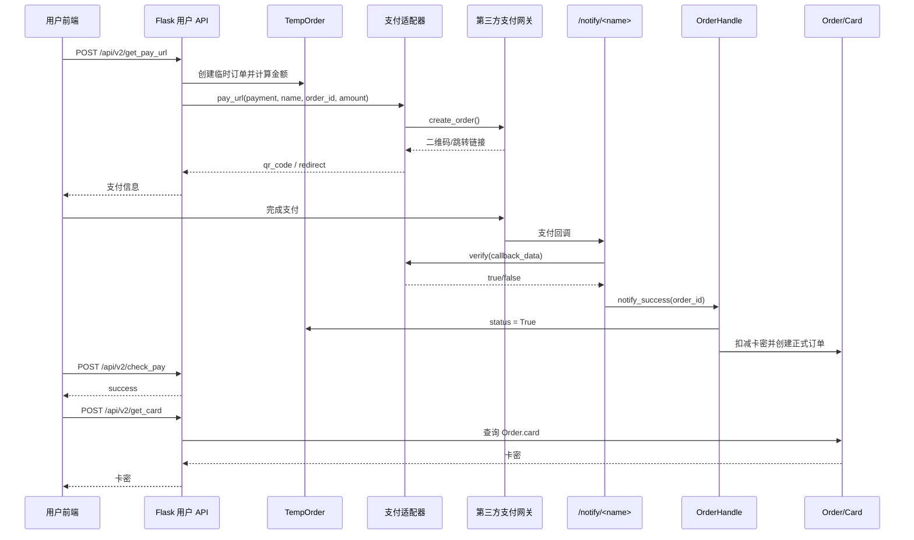

# kamiFaka 项目分析报告

> 分析范围：`README.md`、现有 `Docs` 目录、后端代码、Docker/启动脚本、支付与订单相关模块。当前 `seed` 分支中未发现 `Docs` 目录，`README.md` 中引用的部分教程文档也不在工作区内；因此以下结论以代码库实际逻辑为准。

## 1. 项目使用的技术栈

### 总体架构

这是一个“卡密/虚拟商品发卡”系统，后端使用 Flask 提供页面、API、支付回调和后台接口，前端静态产物已经编译到 `dist/`，由 Flask 直接托管。

核心结构如下：

- 前端：`dist/index.html`、`dist/admin.html`、`dist/static/**`。`README.md` 声称前端是 Vue 3.0 + Stisla UI，但仓库中没有 `package.json`、`src/`、`vite.config.*` 或 `vue.config.*`，所以当前仓库只能确认“已编译的 Vue 静态资源存在”，不能从源码层验证前端构建过程。
- 后端：Python + Flask。
- 数据库：Flask-SQLAlchemy；默认 SQLite，Docker 启动脚本支持通过环境变量切换 MySQL 或 PostgreSQL。
- 认证：后台接口使用 `flask_jwt_extended`，管理员密码使用 `bcrypt`。
- 跨域与限流：`flask_cors`、`flask_limiter`。
- 定时任务：`Flask-APScheduler`，用于清理临时订单。
- 生产运行：Docker + Gunicorn + gevent。
- 支付 SDK/接口：支付宝当面付、微信官方、QQ 钱包、Payjs、虎皮椒、码支付、易支付、YunGouOS、V 免签、云免签、Mugglepay、Stripe 等。
- 通知渠道：邮件、短信、微信推送、Telegram、QQ 推送。

### 后端模块划分

- `app.py`：生产入口，注册 `base`、`admin`、`common` 三个蓝图，并启动定时清理任务。
- `dev.py`：开发入口，和 `app.py` 逻辑基本一致，区别是 `debug=True` 且端口为 `4545`。
- `service/api/db.py`：创建 Flask app、CORS、Limiter、JWT、SQLAlchemy，并配置默认数据库。
- `service/api/user.py`：用户侧 API，包含商品列表、商品详情、下单、支付状态查询、取卡。
- `service/api/admin.py`：后台 API，包含登录、商品、卡密、订单、支付配置、通知配置、系统配置等。
- `service/api/common.py`：页面路由、静态图片、支付回调 `/notify/<name>`。
- `service/database/models.py`：数据库模型，包括 `Payment`、`ProdInfo`、`Card`、`TempOrder`、`Order`、`Notice` 等。
- `service/util/order/create.py`：创建临时订单、按支付名称分发到具体支付模块。
- `service/util/order/handle.py`：支付成功后生成正式订单、扣减卡密、触发通知。
- `service/util/pay/**`：各支付渠道的具体封装。

### UML 类关系图



## 2. 构建和启动流程

### Docker 生产流程

代码层实际流程：

1. `Dockerfile` 使用 `python:3.8-slim`。
2. 复制 `requirements.txt` 并执行 `pip install --no-cache-dir -r requirements.txt`。
3. 复制整个仓库。
4. 暴露 `8000` 端口。
5. 执行 `docker-entrypoint.sh`。
6. `docker-entrypoint.sh` 根据 `DB_TYPE` 修改 `service/api/db.py` 中的数据库 URI：
   - `DB_TYPE=Sqlite`：使用默认 `public/sql/kamifaka.db`。
   - `DB_TYPE=Mysql`：改成 `mysql+pymysql://...`。
   - `DB_TYPE=PostgreSQL`：改成 `postgresql+psycopg2://...`。
7. 启动脚本创建 `public/images`、`public/sql`、`public/backups`，复制默认图片。
8. 执行 `python init_mysql.py` 初始化数据库。
9. 使用 `gunicorn -k gevent --bind 0.0.0.0:8000 ... app:app` 启动服务。

快速运行命令与 README 一致：

```bash
docker run --name kmfaka -itd -p 8000:8000 baiyuetribe/kamifaka:latest
```

如果使用当前源码自行构建：

```bash
docker build -t kamifaka .
docker run --name kmfaka -itd -p 8000:8000 kamifaka
```

MySQL 示例：

```bash
docker run --name kmfaka -itd -p 8000:8000 \
  -e DB_TYPE=Mysql \
  -e DB_HOST=127.0.0.1 \
  -e DB_PORT=3306 \
  -e DB_USER=KAMIFKA \
  -e DB_PASSWORD=PASSWORD \
  -e DB_DATABASE=KAMIFKA \
  kamifaka
```

### 本地开发流程

仓库没有前端源码构建脚本，所以本地主要是运行后端和已编译静态资源：

```bash
pip install -r requirements.txt
python init_mysql.py
python dev.py
```

`dev.py` 会监听 `4545` 端口；`app.py` 直接运行时是 Flask 默认端口，Docker 中则由 Gunicorn 监听 `8000`。

当前本机验证情况：已用 `py -3 -m compileall -q service app.py dev.py init_mysql.py app_tg.py` 做过静态语法编译检查，结果通过。没有发现项目内置测试用例。

### 文档与代码的差异

- README 中提到 `Docs` 下的教程，但当前分支没有 `Docs` 目录。
- README 声称“前端使用 Vue 3.0”，代码库只有 `dist/` 静态产物，没有前端源码和构建配置。
- README 声称支持 SQLite/MySQL/PostgreSQL，这一点与 Docker 启动脚本和 `service/api/db.py` 的配置逻辑基本一致。

## 3. 支付相关接口与代码逻辑

### 对外支付相关接口

用户侧：

- `POST /api/v2/get_pay_url`：创建临时订单并调用支付渠道生成二维码或跳转链接。
- `POST /api/v2/check_pay`：前端轮询临时订单是否已支付；仅对支付宝当面付额外触发主动查询。
- `POST /api/v2/check_pay_auto`：与 `check_pay` 类似，限流更宽。
- `POST /api/v2/get_card`：支付成功并生成正式订单后，根据订单号取卡密。
- `POST /api/v2/get_order`：按联系方式查询最近订单。

回调侧：

- `GET/POST /notify/<name>`：统一支付回调入口。`name` 可为 `alipay`、`wechat`、`xunhupay`、`payjs`、`vmq`、`epay`、`yungou`、`yungouwx`、`codepay`、`qqpay`、`mugglepay`、`stripe`、`ymq`。

后台侧：

- `GET /api/v4/get_pays`：获取全部支付配置。
- `GET/POST /api/v4/update_pays`：查询或更新支付配置、图标和启用状态。

### 购买与支付主流程

1. 前端调用 `/api/v2/theme_list` 和 `/api/v2/detail/<shop_id>` 获取商品、库存、价格、可用支付方式。
2. 用户提交商品名、支付方式、订单号、联系方式、数量到 `/api/v2/get_pay_url`。
3. `user.py` 对支付方式白名单、订单号长度、数量做基础校验。
4. `make_tmp_order()` 创建 `TempOrder`，根据商品和数量计算价格。
5. `make_pay_url()` 根据 `TempOrder.payment` 调用 `pay_url()`。
6. `pay_url()` 通过大量 `if/elif` 按支付名称硬编码分发到具体支付适配器。
7. 第三方支付成功后请求 `/notify/<name>`。
8. `common.py` 根据 `name` 解析回调参数、验签，成功后异步执行 `notify_success(out_order_id)`。
9. `notify_success()` 将 `TempOrder.status` 更新为 `True`，然后调用 `make_order()`。
10. `make_order()` 根据商品 `auto` 决定自动发卡或手工发货：
    - 自动发货：查询 `Card`，返回卡密并把非复用卡密标记为 `isused=True`。
    - 手工发货：订单卡密写入“手工发货，请主动联系客服”。
11. 创建正式 `Order`。
12. 根据 `Notice` 配置通知用户和管理员。
13. 前端轮询 `/api/v2/check_pay` 成功后，再调用 `/api/v2/get_card` 获取卡密。

### 支付流程图



### 支付时序图



## 4. 是否可以增加区块链支付方式

可以增加，但建议先改造支付抽象和订单状态，再接入链上支付。

### 可以增加的理由

1. 现有支付架构已经是“支付配置表 + 创建支付订单 + 回调验签 + 临时订单转正式订单”的模式。新增区块链支付可以按现有 `service/util/pay/<provider>/` 方式新增适配器。
2. `Payment` 表已经能保存支付渠道名称、图标、配置和启用状态，可以保存链 ID、收款地址、RPC/API Key、确认数、代币合约地址等配置。
3. `pay_url()` 当前按支付名称分发，虽然不优雅，但可以继续追加 `elif payment == 'USDT-TRC20'` 或 `payment == 'ETH-USDT'` 之类的渠道。
4. `/notify/<name>` 也可以增加 `blockchain` 分支；如果使用第三方链上支付服务，可以用 webhook；如果自建监听，可以由定时任务或后台 worker 轮询链上交易。
5. 当前系统的核心发货动作集中在 `notify_success(out_order_id)`，只要链上支付确认后调用该函数，就能复用后续发卡、订单创建和通知流程。

### 需要补强的点

1. 当前订单模型没有链上交易字段。建议为临时订单或新表增加 `chain`、`token`、`pay_address`、`expected_amount`、`tx_hash`、`confirmations`、`expires_at`、`paid_amount`、`pay_status`。
2. 链上支付不能只看“回调到了”。必须校验交易哈希、收款地址、币种/合约、金额、确认数、是否重复使用交易、是否超时。
3. 区块链支付存在价格波动。需要在创建订单时锁定汇率、过期时间和允许误差。
4. 当前 `TempOrder.status` 只有布尔值，不足以表达 `pending`、`confirmed`、`underpaid`、`expired`、`failed`、`refunded`。
5. 当前 `pay_url()` 使用支付名称硬编码分发，新增支付越多越难维护。建议改为“支付适配器注册表”，例如 `{payment_name: AdapterClass}`。

### 建议接入方案

- 第一步：新增数据库字段或新建 `PaymentTransaction` 表，记录每次支付尝试。
- 第二步：新增 `service/util/pay/blockchain/usdt.py`，实现 `create_order()`、`verify()`、`check()`。
- 第三步：在 `Payment` 初始化配置中加入 `USDT-TRC20` 或 `USDT-Polygon`。
- 第四步：在 `/notify/blockchain` 或轮询任务中校验链上交易，确认后调用 `notify_success(out_order_id)`。
- 第五步：补并发锁和幂等逻辑，确保同一笔链上交易不会给多个订单发货。

## 5. 购买与支付模块 BUG Review

结论：有 BUG，而且有几类会直接影响支付成功后的发货可靠性和资金安全。

| 严重级别 | 位置 | 问题 | 影响 | 建议 |
| --- | --- | --- | --- | --- |
| 高 | `service/api/common.py:238-240` | `/notify/<name>` 最外层 `except: pass`，最后总是返回 `success`。 | 回调解析、验签、创建订单失败时，第三方也可能认为通知成功，不再重试；会出现“用户已付款但系统未发货”。 | 捕获具体异常并记录；验签失败返回失败状态；只有订单处理成功后才返回第三方要求的成功响应。 |
| 高 | `service/api/common.py:218-247`、`service/util/pay/stripe/api.py:21-38` | Stripe 逻辑只依赖 return URL 上的 `source + client_secret` 与数据库匹配，没有查询 Stripe Source/PaymentIntent 的真实支付状态，也没有 webhook 签名校验。 | 用户跳转回来不等于支付成功，可能误发货；也无法可靠处理异步支付结果。 | 使用 Stripe Webhook，校验签名，查询并确认支付对象状态、金额、币种和订单号后再发货。 |
| 高 | `service/util/order/handle.py:21-35` | `notify_success()` 先把 `TempOrder.status` 更新为 `True`，再执行 `make_order()`；如果扣卡或创建正式订单失败，临时订单已经显示支付成功。 | 前端轮询会看到成功，但 `Order` 未创建或卡密缺失，用户无法取卡。 | 订单创建、扣卡、状态更新放入同一个事务；或先创建正式订单成功后再置 `TempOrder.status=True`。 |
| 高 | `service/util/order/handle.py:52-100` | 自动发卡扣库存没有行锁/原子条件更新；多个回调或并发订单可能同时读到同一张未使用卡。 | 可能超卖或重复发同一卡密。 | 使用数据库事务和条件更新，例如 `UPDATE card SET isused=1 WHERE id=? AND isused=0` 并检查影响行数；必要时加唯一约束和重试。 |
| 高 | `service/util/order/handle.py:80-87` | 多数量购买且库存不足时，代码执行 `','.join(pre_card + [None ...])`，列表包含 `None` 会触发 `TypeError`。 | 用户付款后可能无法创建正式订单，且临时订单可能已被标记成功。 | 下单前校验库存；库存不足直接阻止支付；不要把 `None` 加入 `join`；不足时创建待补发订单并明确状态。 |
| 中高 | `service/api/user.py:129-139` | 下单接口只检查支付名称是否在白名单，没有校验 `Payment.isactive=True`。 | 用户可以直接调用未启用或未配置完成的支付渠道，造成异常订单或测试配置泄露风险。 | 服务端根据 `Payment` 表确认渠道存在且启用，再允许创建订单。 |
| 中高 | `service/util/pay/mugglepay/mugglepay.py:56-60` | Mugglepay 回调只校验 `token == md5(order_id + TOKEN)`，没有校验回调中的支付状态、金额、币种，也没有主动查询订单。 | 回调数据完整性不足；金额不符、币种不符或伪造状态的风险无法被发现。 | 回调验签后再主动调用 Mugglepay 查询订单，确认状态、金额、币种、订单号一致。 |
| 中 | `service/util/order/create.py:80-84` | `PAYJS支付宝` 分支内判断写成 `if payment == 'PAYJS支付'`，无法匹配真实名称 `PAYJS支付宝`，会走 `wechat` 配置。 | PAYJS 支付宝会错误使用微信通道配置，生成错误支付订单。 | 改成 `if payment == 'PAYJS支付宝'`。 |
| 中 | `service/api/common.py:154-160` | 易支付回调中判断微信支付写成 `elif name == 'wxpay'`，此处 `name` 恒为 `epay`，应该判断 `pay_type`。 | 易支付微信回调会被当成 QQ 支付验签，导致支付成功无法确认。 | 改成 `elif pay_type == 'wxpay'`。 |
| 中 | `service/database/models.py:339`、`service/database/models.py:239` | `TempOrder.out_order_id` 和 `Order.out_order_id` 没有唯一约束。 | 重复订单号可产生多条临时订单或正式订单，幂等依赖应用层 `first()`，并发下不可靠。 | 数据库层增加唯一索引；回调处理使用幂等状态机。 |
| 中 | `service/database/models.py:68`、`service/database/models.py:558`、`service/database/models.py:585` | 支付、插件、通知配置使用 `eval(self.config)` 解析。 | 管理员配置内容如果被污染，会造成代码执行风险。 | 使用标准 JSON，保存时 `json.dumps`，读取时 `json.loads`。 |
| 中 | `service/database/models.py:390-397` | 四层批发价计算用 `split('#')[0][0]`、`[1]`、`[2]` 取字符，而不是按逗号分割后的档位。 | 阈值为多位数时价格计算错误，可能导致少收或多收。 | 统一解析为整数数组，例如 `levels = [int(x) for x in part.split(',')]`。 |
| 低到中 | `service/util/pay/pay_config.py:5-9` | `get_config()` 直接 `.first().all_json()`，配置不存在会抛异常。 | 缺失支付配置时接口返回泛化 400/500，排查困难。 | 显式判断配置不存在并返回清晰错误。 |
| 低到中 | `requirements.txt` | 除 `flask_jwt_extended`、`python-alipay-sdk` 外，多数依赖未固定版本。 | 新环境构建可能因依赖升级出现兼容问题。 | 固定关键依赖版本，增加构建锁定文件或至少记录已验证版本。 |

### 建议优先修复顺序

1. 修复回调异常吞掉且总返回成功的问题。
2. 调整 `notify_success()` 的事务顺序，确保正式订单和卡密生成成功后再标记支付成功。
3. 给 `out_order_id` 增加唯一约束，补订单处理幂等。
4. 修复库存不足 `join(None)`、PAYJS 支付宝分发、易支付微信回调判断。
5. 重做 Stripe/Mugglepay 等异步支付的状态校验。
6. 把支付分发从硬编码字符串升级为适配器注册表。

