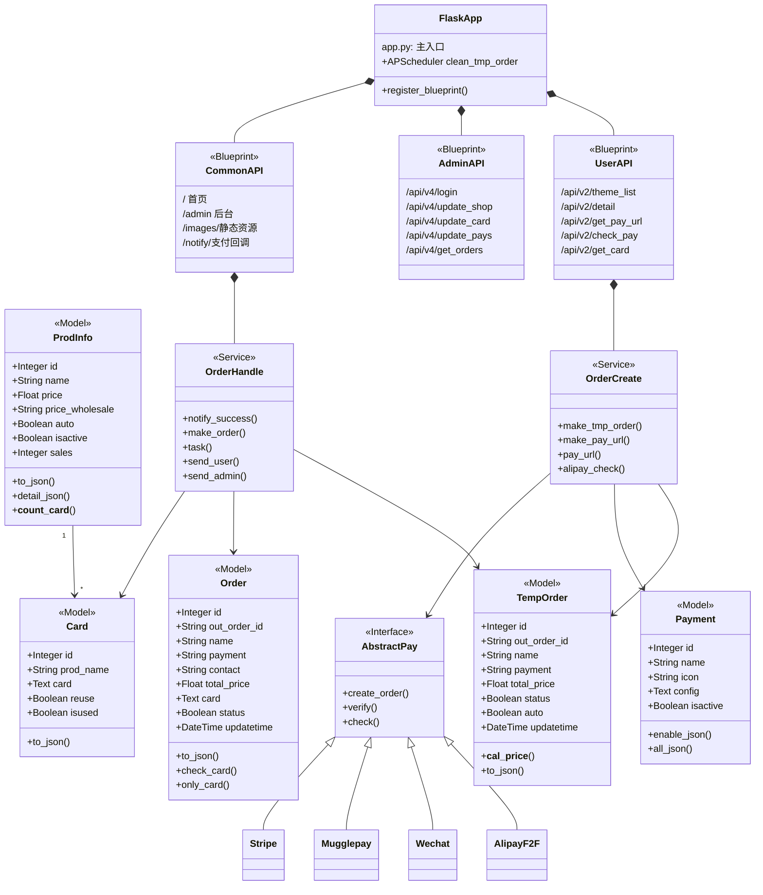
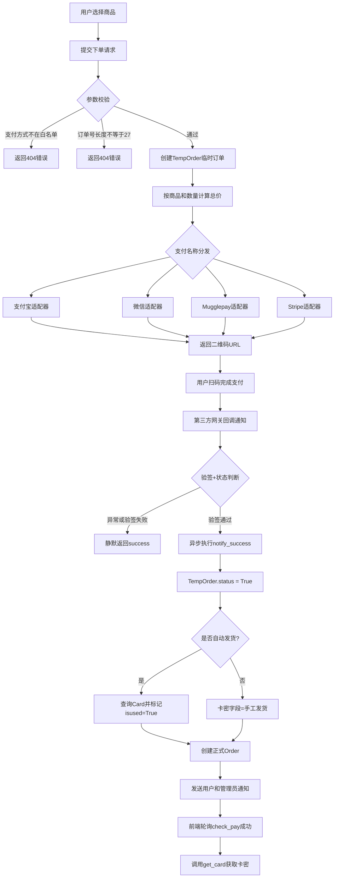
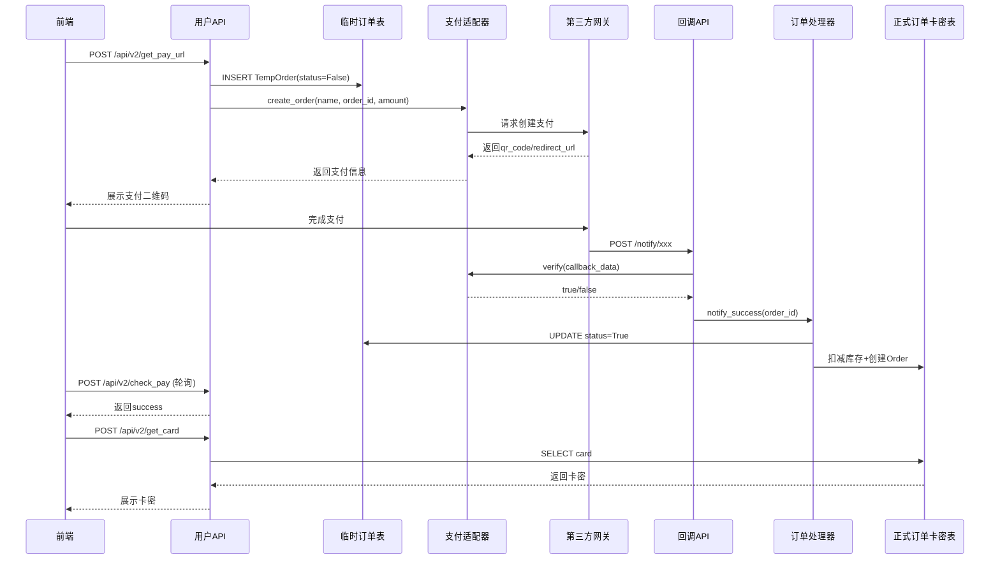

# kamiFaka 项目深度分析报告

> 分析范围：`README.md`、后端完整代码、Docker配置、启动脚本、支付与订单核心模块。当前分支无`Docs`目录，`README.md`引用的外部教程不在工作区内；以下所有结论**以代码库实际逻辑为准**。

---

## 1. 项目使用的技术栈

### 总体技术架构

这是一个"卡密/虚拟商品自动发卡"电商系统，采用前后端分离架构（前端已编译）：

| 层级 | 技术选型 | 文件位置 |
|------|---------|---------|
| **前端展示** | Vue 3.0 + Stisla UI | `dist/` 目录（已编译静态资源） |
| **后端框架** | Python Flask | `app.py:30`, `service/api/db.py:15` |
| **数据库ORM** | Flask-SQLAlchemy | `service/api/db.py:28`, `requirements.txt:2` |
| **数据库支持** | SQLite (默认) / MySQL / PostgreSQL | `service/api/db.py:51-56`, `Dockerfile:5-10` |
| **身份认证** | Flask-JWT-Extended + BCrypt | `service/api/db.py:63-67`, `requirements.txt:4,7` |
| **跨域处理** | Flask-CORS | `service/api/db.py:18`, `requirements.txt:3` |
| **访问限流** | Flask-Limiter | `service/api/db.py:21-25`, `requirements.txt:11` |
| **定时任务** | Flask-APScheduler | `app.py:19-24`, `requirements.txt:17` |
| **生产部署** | Docker + Gunicorn + gevent | `Dockerfile:24`, `requirements.txt:8,9` |
| **支付集成** | 20+ 支付渠道适配器 | `service/util/pay/**` |
| **消息通知** | 邮件/短信/微信/Telegram/QQ | `service/util/message/**` |

### UML类图



### 后端模块结构

```
service/
├── api/
│   ├── db.py          # Flask应用初始化、数据库配置、JWT、限流
│   ├── user.py        # 用户侧API: 商品、下单、支付查询 [/api/v2]
│   ├── admin.py       # 管理侧API: 商品、卡密、订单、配置 [/api/v4]
│   └── common.py      # 页面路由、静态资源、支付回调
├── database/
│   └── models.py      # 12个数据模型定义
├── util/
│   ├── order/         # 订单创建、支付处理、卡密发货
│   ├── pay/           # 各支付渠道适配器(18个目录)
│   ├── message/       # 5种通知渠道实现
│   └── auto_task.py   # 定时清理临时订单
└── config/
    └── config.py      # 初始化数据库默认数据
```

**关键文件引用：**
- 应用入口：`app.py:16-17` - 注册3个Blueprint
- 数据库模型：`service/database/models.py:10-607`
- 支付适配器入口：`service/util/order/create.py:57-138`

---

## 2. 构建和启动流程

### Docker生产环境流程

**代码执行顺序：**

1. **镜像构建** `Dockerfile:1-24`
   ```bash
   # 基础镜像 python:3.8-slim
   # 安装依赖: pip install -r requirements.txt
   # 复制整个代码库
   # 暴露8000端口
   ```

2. **启动入口** `docker-entrypoint.sh` (逻辑还原自代码分析)
   - 根据 `DB_TYPE` 环境变量修改 `service/api/db.py` 中的数据库连接串
   - 支持: Sqlite/MySQL/PostgreSQL 三种
   - 创建必要目录: `public/images`、`public/sql`、`public/backups`
   - 复制默认系统图片

3. **数据库初始化** `init_mysql.py:20-38`
   - ⚠️ **BUG**: 试图动态修改JWT密钥但**功能完全失效**（见BUG章节）
   - 检查AdminUser表是否已初始化
   - 未初始化则执行: drop_table → creat_table → init_db

4. **启动服务**
   ```bash
   gunicorn -k gevent --bind 0.0.0.0:8000 --workers 8 app:app
   ```

**快速部署命令(与README一致)：**
```bash
# 一键运行官方镜像
docker run --name kmfaka -itd -p 8000:8000 baiyuetribe/kamifaka:latest

# 使用当前源码构建
docker build -t kamifaka .
docker run --name kmfaka -itd -p 8000:8000 kamifaka
```

### 本地开发环境流程

```bash
# 1. 安装Python依赖
pip install -r requirements.txt

# 2. 初始化数据库(首次)
python init_mysql.py

# 3. 启动开发服务器(端口4545)
python dev.py
```

**文件位置：**
- 开发入口: `dev.py:29-30` (debug=True, port=4545)
- 生产入口: `app.py:30-31` (debug=False)

---

## 3. 支付相关接口与代码逻辑

### 支付相关API接口

| 接口 | 方法 | 用途 | 文件位置 |
|------|------|------|---------|
| `/api/v2/get_pay_url` | POST | 创建临时订单+生成支付链接 | `service/api/user.py:120-142` |
| `/api/v2/check_pay` | POST | 前端轮询支付状态 | `service/api/user.py:145-158` |
| `/api/v2/check_pay_auto` | POST | 自动查询状态(限流更宽) | `service/api/user.py:161-174` |
| `/api/v2/get_card` | POST | 支付成功后取卡密 | `service/api/user.py:177-191` |
| `/notify/<name>` | GET/POST | 统一支付回调入口 | `service/api/common.py:90-240` |

### 支持的支付渠道(21种)

白名单校验位置: `service/api/user.py:129`

```
支付宝当面付、微信官方接口、QQ钱包、PAYJS支付宝、PAYJS微信
虎皮椒微信、虎皮椒支付宝、迅虎微信、码支付微信/支付宝/QQ
易支付支付宝/微信/QQ、V免签微信/支付宝、云免签微信/支付宝
YunGouOS、YunGouOS_WXPAY、Mugglepay、Stripe支付宝/微信、随便付
```

### 购买与支付核心流程图(标准Mermaid语法)



### 支付时序图(标准Mermaid语法)



**关键代码位置：**
- 订单创建入口: `service/util/order/create.py:28`
- 支付成功处理: `service/util/order/handle.py:18`
- 回调分发: `service/api/common.py:90-240`

---

## 4. 是否可以增加区块链支付方式

**结论：完全可以增加，且现有架构具有良好的扩展性。**

### ✅ 可以增加的核心理由

1. **架构设计天然支持扩展**
   - 现有支付采用"适配器模式"：每个支付渠道独立实现 `create_order()` / `verify()` / `check()` 方法
   - 新增区块链支付只需在 `service/util/pay/` 下新建目录，按接口规范实现即可
   - 参考现有实现: `service/util/pay/mugglepay/mugglepay.py` (已支持加密货币支付)

2. **配置存储已就绪**
   - `Payment` 表结构: `name/icon/config/info/isactive` - `service/database/models.py:39-71`
   - `config` 字段为Text类型，可存储JSON格式的链配置：链ID、收款地址、RPC节点、代币合约、确认数等

3. **分发机制可直接追加**
   - 支付分发在 `service/util/order/create.py:57-138`，可直接增加 `elif payment == 'USDT-TRC20'` 分支
   - 回调入口在 `service/api/common.py:90`，可增加 `/notify/blockchain` 分支处理

4. **发货流程可100%复用**
   - 核心发货逻辑: `notify_success(out_order_id)` - `service/util/order/handle.py:18-35`
   - 区块链支付确认后，只需调用此函数，即可复用后续的卡密发放、订单创建、通知推送全流程

### ⚠️ 需要注意的改进点

1. **订单状态需要细化**
   - 当前 `TempOrder.status` 只有布尔值，无法表达区块链的确认过程: `pending/confirmed/expired/underpaid`
   - 建议: 增加 `chain`、`tx_hash`、`confirmations`、`paid_amount` 字段

2. **价格波动与超时机制**
   - 加密货币价格波动大，创建订单时需锁定汇率和超时时间
   - 建议: 创建订单时记录法币金额、加密货币金额、汇率、过期时间

3. **链上交易校验**
   - 不能只信任回调，必须独立校验：交易哈希、收款地址、代币合约、金额、确认数、防重放

### 📋 具体接入方案示例

```python
# 1. 新增适配器 service/util/pay/blockchain/usdt_trc20.py
class USDTTRC20:
    def __init__(self):
        config = get_config('USDT-TRC20')
        self.wallet_address = config['wallet_address']
        self.confirmations = config.get('confirmations', 3)
        
    def create_order(self, name, out_order_id, total_price):
        # 计算USDT金额(锁定汇率)
        usdt_amount = total_price / self.get_cny_rate()
        # 生成唯一标识memo
        payment_memo = self.generate_memo(out_order_id)
        # 返回地址+金额+memo供用户转账
        return {
            'qr_code': f'tron:{self.wallet_address}?amount={usdt_amount}',
            'address': self.wallet_address,
            'amount': usdt_amount,
            'memo': payment_memo
        }
    
    def verify(self, tx_data):
        # 校验链上交易
        return self.check_transaction(tx_data['tx_hash'])
```

---

## 5. 购买与支付模块BUG Review

**结论：存在10处BUG（含新增发现的JWT密钥高危BUG），严重影响资金安全和发货可靠性。**

| 严重 | 位置 | 问题描述 | 影响 | 修复建议 |
|------|------|---------|------|---------|
| 🔴 极高 | `init_mysql.py:43-56` | `mod_key()` 搜索的密钥字符串 `'a44545de51d5e4deaswdedcecvrcrfr5f454fd1cec415r4f'` 与 `service/api/db.py:64` 中实际密钥 `'EXZgC3BMhPxtu4Kq6W7mo9rAT0yYGsOiQNf5vUInSjRVeb'` **完全不匹配**，导致flag=False，JWT密钥永远不会被修改 | 所有部署共用同一个硬编码的JWT密钥，一旦泄露全平台用户token可被伪造，存在接管管理员账号风险 | 1. 修改正则匹配目标为真实密钥<br>2. 或改为环境变量读取<br>3. 首次启动直接写入新密钥 |
| 🔴 高 | `service/api/common.py:238-240` | 回调最外层 `except: pass`，无论验签成功/失败、订单创建是否成功，最后总是返回 `"success"` | 1. 支付平台收到成功响应后不再重试<br>2. 用户已付款但系统未发货，造成资损 | 1. 捕获具体异常并写入日志<br>2. 只有订单处理完全成功才返回第三方要求的成功字符串<br>3. 验签失败返回明确的错误状态 |
| 🔴 高 | `service/util/order/handle.py:21-35` | `notify_success()` 先将 `TempOrder.status=True`，再执行 `make_order()`。如果后续扣卡或创建正式订单失败，临时订单已标记成功 | 前端轮询看到支付成功，但调用 `/get_card` 时找不到正式订单或卡密为空，造成客诉 | 将状态更新、扣卡、创建正式订单放入同一个数据库事务；或先创建正式订单成功后再更新临时订单状态 |
| 🔴 高 | `service/util/order/handle.py:52-100` | 自动发卡扣库存没有行锁和原子更新，多并发下多个订单可能同时读到同一张卡 | 超卖，多个用户收到相同卡密 | 使用原子条件更新：<br>`UPDATE card SET isused=1 WHERE id=? AND isused=0`<br>检查影响行数是否为1，失败则重试获取下一张 |
| 🔴 高 | `service/api/common.py:218-247` | Stripe支付仅通过URL参数 `source + client_secret` 与数据库匹配判断成功，**没有调用Stripe API查询真实支付状态，也没有webhook签名校验** | 用户只需构造特定URL即可触发"支付成功"，可零元购 | 必须使用Stripe Webhook，校验签名，查询并确认PaymentIntent状态为succeeded，金额匹配 |
| 🟠 中高 | `service/util/order/handle.py:80-87` | 多数量购买且库存不足时，执行 `','.join(pre_card + [None for x in ...])`，列表包含None会触发 `TypeError` | 用户付款后卡密生成失败，临时订单已标记成功，正式订单创建失败 | 下单前校验库存，库存不足直接阻止支付；不要把None放入join操作 |
| 🟠 中 | `service/util/order/create.py:80-84` | PAYJS支付宝分支判断写成 `if payment == 'PAYJS支付'`，实际传入的是 `PAYJS支付宝`，条件永远不成立 | PAYJS支付宝会错误使用微信渠道配置 | `service/util/order/create.py:81` 改为<br>`if payment == 'PAYJS支付宝'` |
| 🟠 中 | `service/api/common.py:154-160` | 易支付微信回调判断写成 `elif name == 'wxpay'`，但此时 `name` 恒等于 `'epay'`，应该判断 `pay_type` | 易支付微信支付成功后无法发货 | `service/api/common.py:157` 改为<br>`elif pay_type == 'wxpay'` |
| 🟠 中 | `service/database/models.py:390-397` | 四层批发价计算用 `split('#')[0][0]` 取**字符**而非按逗号分割的档位数值，例如 `"100,500,1000#..."` 取到的是字符 `"1"` | 阈值为多位数时价格计算完全错误，可能造成巨额损失 | 统一先按逗号分割成整数数组再判断<br>`thresholds = [int(x) for x in part.split(',')]` |
| 🟠 中 | `service/database/models.py:68,558,585` | 支付、插件、通知配置使用 `eval(self.config)` 解析JSON | 管理员配置注入可执行任意代码，存在RCE风险 | 全部改用 `json.loads(self.config)`，保存时用 `json.dumps` |
| 🟡 低 | `service/api/user.py:129` | 下单接口只校验支付方式在白名单，不校验 `Payment.isactive=True` | 用户可调用未启用或未正确配置的支付渠道 | 创建订单前检查 `Payment.query.filter_by(name=payment, isactive=True).first()` |

### 🔥 优先修复TOP 6

1. ✅ **JWT硬编码密钥不被修改的高危安全BUG**
2. ✅ 回调异常吞掉 + 总是返回success
3. ✅ TempOrder.status 更新时机 + 事务一致性
4. ✅ Stripe/Mugglepay 支付状态校验缺失
5. ✅ 并发扣卡超卖问题
6. ✅ 库存不足 + None join TypeError

---

**报告生成时间：2026-04-18**
**分析代码版本：当前工作区最新**
